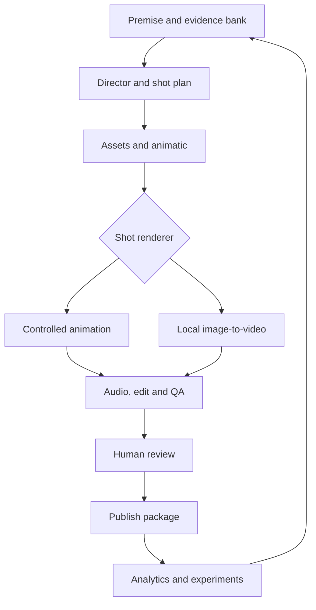

# Pipeline architecture

## Runtime design

Start with one Python application, SQLite and a filesystem artifact store. Heavy inference runs in isolated worker processes/containers so memory can be released between stages. A database-backed GPU lease serialises them across all workers. CPU validation, metadata and editing may run concurrently within configured limits.

An AI role is a schema-constrained task with a versioned prompt, not necessarily a separate model or service. Director, writer and critic initially share a local language-model adapter with isolated task contexts. A deterministic controller owns the workflow and budgets; model output cannot schedule arbitrary commands or spend money.

Expensive production begins after plan validation and an animatic. In exploratory mode, human storyboard/asset selection can pause the run. In overnight mode, previously approved series assets and rules permit bounded automated candidate selection; final publishing review remains separate.

## Proposed modules

| Module | Responsibility |
| --- | --- |
| `config`, `schemas` | Strict configuration, migrations and canonical serialisation |
| `premises` | Original briefs, evidence references, source dates and hypothesis labels |
| `planning` | Director/writer/critic calls, typed plans, constraint checks |
| `assets` | Character/world bible, references, licenses, versions and hashes |
| `providers` | Text, image, video, audio adapters and capability discovery |
| `rendering` | Scene interpreter, animatic, clip compositing, FFmpeg timeline |
| `qa` | Technical checks, state checks, editorial observations |
| `jobs` | SQLite jobs, dependencies, leases, retries, cancellation and budgets |
| `review` | Static review export, decisions and approval ledger |
| `publishing` | Export packages; later authorised platform writes |
| `analytics` | CSV/API ingestion, metric definitions, cohorts and reports |
| `costs` | Runtime, energy provenance, rejected attempts and manual effort |
| `cli` | Thin command layer exposing the same application functions |

Target layout: `src/svf/`, `tests/`, `configs/`, `prompts/`, `schemas/`, `docs/`, `docker/`. Large assets, runs, model weights, secrets and database files stay out of git. Use ordinary versioned JSON/YAML prompts and records before introducing a vector database.

## Clip backends

Controlled animation executes a finite supported vocabulary: move along path, look, pose, pick up, carry, place, switch, door/bridge state, camera movement, cut and sound cue. Define preconditions/postconditions and enforce object identity. It can use generated stills, layered illustrations or sprites, with anchors and masks curated into asset packs. Do not assume a text-to-image model produces production-ready sprite sheets automatically.

I2V consumes a selected keyframe, motion prompt, explicit capability-compatible settings and reference asset IDs. It is suitable for atmospheric motion, reactions and attractive shots. Complex precise interaction must earn its place through benchmarks. The director can request I2V but the scheduler may only use a declared, recorded fallback after a failed gate.

A character reference reduces inconsistency; it does not guarantee it. Store independent shot identity checks and continuity notes. Composite approved objects and captions after generation where that improves control.

## Model residency and resources

Load planner → unload; load image generator → unload; load video generator → unload; optionally load visual critic → unload. Group similar stages when it saves load time without starving older jobs. Limit GPU concurrency to one initially. Whole-system `MemAvailable`, process RSS and framework allocation are different metrics on unified-memory hardware; label them individually. NVIDIA GPU memory statistics may be unavailable.

Check free disk before downloads and attempts. Cache weights once; cache valid outputs by all relevant input hashes. Do not prune the known-working model cache automatically. Apply retention to reproducible intermediate files only after a successful final artifact and explicit configured policy.

## Durability and recovery

Use SQLite transactions with WAL on a local disk, claim timestamps, expiring leases and fencing tokens. Heartbeat active jobs; commits from expired owners are rejected. Kill/reap stale workers before reclaiming the GPU. Do not run this design over a network filesystem or pretend it supports distributed machines.

Write outputs into attempt-specific temporary paths. Verify them, calculate hashes and atomically rename before recording success. On crash between rename and DB commit, reconcile manifests and hashes rather than infer success from filename alone. Never overwrite an accepted artifact in place.

Cache keys include input artifacts, config, model revision, adapter/code version and prompt version. A title-only edit invalidates packaging/approval; a character asset edit invalidates dependent visual stages. Record the dependency graph explicitly.

## Review and publishing

MVP review is a local HTML bundle and CLI decisions. Escape all supplied text in HTML. Bind future servers to localhost and use SSH forwarding by default. Review must show full clips with sound, not only selected attractive frames.

Separate production state from publication state. A render succeeds into `ready_for_review`; only a human decision creates approval. Publication records include exact media, captions, title, description, cover, audience designation and disclosure selections. Later edits invalidate approval. Uploaded/private/public states remain distinct.
